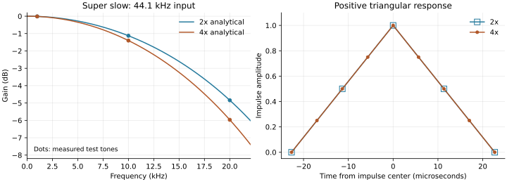

# PCM audio processing, v0.5.0

The raw native pipeline remains separate from the DSP pipeline. Disabling both EQ and SRC preserves the decoded integer samples and rate, including native-width expansion and mono duplication. No DSP gain or dither is applied to that path.

## Producer and device callback

`BufferedAudioSource` owns one background producer and a bounded single-producer/single-consumer byte ring. Acquire/release publication prevents partial buffers from reaching the consumer. The producer owns decoder reads and all EQ/SRC/quantization work. The callback copies bytes, signals free space, and returns silence on starvation without treating it as EOF. Decoder errors are reported through the output backend and cannot trigger repeat.

The default capacity is 40 ms, with a user range of 20–200 ms. Capacity is enlarged to cover two ASIO blocks or the requested WASAPI buffer, whichever is applicable. Initial prefill runs before device start. This is preparation time, not an artificial timer delay. Total hardware latency is not inferred from ring capacity.

On Windows the producer requests the MMCSS `Pro Audio` task with high multimedia priority. Registration and reversion happen on that same producer thread. If the OS declines registration, normal scheduling remains available; no process-wide real-time priority is set.

Pause retains the queue. Seek stops the device and producer, discards the queue and DSP state, and restarts from the requested source frame. DSP seeks decode up to 200 ms before the target to warm filter/SRC history and discard the corresponding output. Native seeks preserve exact sample boundaries. SRC's end-of-input flush is drained before EOF. The timeline counts consumed real output frames, converts them back to source time, and does not advance for starvation silence. No hardware clock correction or gapless repeat is claimed.

## EQ, precision, and peaks

15 peaking biquads use double coefficients and independent transposed-direct-form-II states per channel. The section Q is sqrt(2), approximately a one-octave bandwidth away from Nyquist. The realized response near Nyquist differs from an analog constant-bandwidth curve. Bands at or above 0.49 times the input rate are bypassed. Zero-gain sections are bypassed.

The combined cascade response is evaluated on 8,193 linear-frequency points plus all valid band centers. Auto headroom subtracts the largest positive gain and adds a 3 dB margin when EQ boosts or SRC is active. This sampled response is not a mathematical transient bound. Post-SRC peaks and overload counts are monitored before device quantization. Excess values saturate; there is no dynamic limiter.

Gain/section updates on an active DSP path use a 20 ms output crossfade between old and new EQ instances without reopening the driver. Source samples and SRC state remain continuous. Changing rate, an active SRC filter, or enabling/disabling the whole DSP path reinitializes output at the current position and preserves pause state. Selecting a filter with SRC off does not turn SRC or DSP on.

Integer samples decode directly to doubles without an intermediate float32 stage. libsoxr uses float64 input/output and the explicit DOUBLE_PRECISION flag. Output is quantized once to the effective device bit depth. Native-rate integer narrowing remains rejected; the explicit DSP path can quantize to a narrower supported device. ASIO's final container packing only shifts already-quantized integer values. TPDF uses a deterministic xorshift32 generator, with no noise shaping; it applies only to DSP integer output. Float32 device output is rounded directly from double and receives no dither.

## Resampler

libsoxr 0.1.3 is built from the vendored unmodified archive whose SHA-256 is recorded in the build scripts and third-party README. The configuration enables CR64 and CR64S, disables float32 and variable-rate engines, OpenMP and LSR bindings, and links the Windows C runtime statically. The DLL remains separately replaceable. Source, licenses and rebuilding instructions accompany the application.

Runtime settings: recipe SOXR_24_BITQ (5), SOXR_DOUBLE_PRECISION (16), linear phase, one thread, minimum DFT log2 8, large DFT log2 10. These deliberately favor smaller batches over maximum throughput. Only integer 2×/4× ratios are offered; device support is checked before the worker and device start. libsoxr compensates its filter alignment and flushes to the expected multiplied frame count.

### Super slow

The optional `SuperSlow` mode uses first-order hold (linear interpolation) in double precision: for input frames `x[n]`, multiplier `L`, and phase `r = 0..L-1`, output `y[nL+r] = (1-r/L)x[n] + (r/L)x[n+1]`. Each channel has independent history. This is zero insertion followed by a triangular FIR with `h[k] = 1-|k|/L` for `|k| < L`; phase sums equal one, preserving DC. There are 3 nonzero output-rate taps for 2× and 7 for 4×. Coefficients are nonnegative, so interpolation stays between adjacent samples and has no oscillatory pre/post ringing or overshoot. The aligned impulse has a short positive pre-response, not an absence of all pre-response.

One input frame of lookahead aligns original samples to their original timeline, rather than adding a one-frame playback offset. At 44.1/48 kHz this is approximately 22.68/20.83 microseconds of signal lookahead, not the player's total startup or hardware latency. Input/output blocks may split at any phase. EOF holds the final sample for its last interval, yielding exactly `N*L` frames for `N` input frames (including single-frame tracks). No extra tail is appended. Seek preroll is discarded on the same timeline as standard SRC, and repeat creates fresh state. Steady processing allocates no managed objects and runs only on the producer.

Frequency-response magnitude, normalized to DC, is `[sin(pi*f/Fs) / (L*sin(pi*f/(L*Fs)))]^2`. It deliberately allows gradual high-frequency droop and residual interpolation images. Measured steady-state tones before quantization:

| Input rate / tone | 2× gain | 4× gain | 2× first image, relative to fundamental | 4× first image |
| --- | --- | --- | --- | --- |
| 44.1 kHz / 1 kHz | −0.01102 dB | −0.01378 dB | −57.92540 dBc | −63.63931 dBc |
| 44.1 kHz / 10 kHz | −1.12611 dB | −1.40308 dB | −17.17553 dBc | −20.32083 dBc |
| 44.1 kHz / 20 kHz | −4.84055 dB | −5.96666 dB | −2.54600 dBc | −3.07169 dBc |
| 48 kHz / 22 kHz | −4.95499 dB | −6.10570 dB | −2.28048 dBc | −2.75163 dBc |

The plot uses the analytical FIR response with measured test-tone points. Regenerate it with `python scripts/plot-super-slow.py` (optional developer dependencies: NumPy and Matplotlib). Reproduce measurements with `dotnet test tests/ChatPi.Core.Tests/ChatPi.Core.Tests.csproj -c Release --filter FullyQualifiedName~SuperSlowTests --logger "console;verbosity=detailed"`. A local Linux run rendered 1 second of mono audio in about 2–3.5 ms in the test helper; that includes helper allocation and output collection and is an observation, not a CPU percentage or real-time guarantee.

`Standard` remains the default for old/missing filter settings and retains the original libsoxr configuration. `Filter` is saved independently of EQ and multiplier, and applies only when SRC is enabled. Both filters share EQ, headroom, dither, device quantization, bounded buffering and ASIO/WASAPI output. Auto headroom retains the existing 3 dB SRC margin for both modes. This mode does not reproduce a specific DAC manufacturer's filter; the final response/ringing also depends on the DAC's subsequent processing.

## Validation and limits

Portable tests measure all 15 center gains, channel isolation, disabled low-rate bands, overlapping boosts and applied headroom, 2×/4× duration and spectral image rejection, short-file draining, effective output bits, unbiased TPDF statistics, and decoder-blocked callback behavior. The native off path is compared byte for byte. Seek, replay and live EQ update are exercised through the buffered pipeline.

Super slow tests additionally verify finite positive impulse support, monotonic step response, exact DC/length/sample anchors, channel independence, fragmented blocks, EOF, seek/loop behavior, response/image agreement with the formula, zero steady-state allocation, filter persistence/defaults and unused-filter native bypass. Windows UI tests exercise the actual Apply button, active/paused filter switching, labels and restart persistence. Real FLAC is rendered through the ASIO packing callback using both filters without physical hardware.

Spectral acceptance: less than 0.001 dB amplitude error at the tested passband tones and at least 120 dB suppression of the first image, measured in double PCM before device quantization with steady-state tone projection. Test cases include 44.1/48/96 kHz inputs and high-frequency tones near 20/22 kHz. These checks are sampled cases, not a sweep guarantee for every frequency or a claim about DAC analog performance. Processing times logged by tests are observations on the runner, not real-time guarantees. Windows UI tests cover persistence, applied-preamp display, live EQ without output recreation and paused rate changes.

Physical ASIO/WASAPI output, actual driver rate, hardware buffering and long-running stability require the Windows checks in `windows-testing.md`.

## ASIO clock transitions and diagnostics

On a rate change, set and verify the new rate in a bufferless session, release that session, then reopen the driver before negotiating formats and creating playback buffers. Reopening is bounded to one attempt; a driver which restores its default rate on init is configured again. Matching rates avoid this extra open. Sample rate and channel types are read from the actual driver, not cached capability snapshots. Rate mismatches after setting, buffer creation or before start, and type changes during buffer creation fail explicitly.

This is a compatibility measure for USB driver state across clock changes, not a confirmed diagnosis of the reported physical FLAC/native-rate silence. A hardware-free Windows regression test decodes real 16/24-bit FLAC and MP3/WAV, renders 2×/4× through the ASIO callback, saves SRC off, reloads settings, then compares the native ASIO buffers against every decoded sample. Other tests cover rejected readback, cleanup after reopening fails, default-rate restoration and format changes.

`%LOCALAPPDATA%/ChatPi/audio.log` records initialization and one transfer snapshot about one second after start, plus stop/disposal. The audio callback counts bytes and nonzero packed buffers using a byte scan, with no logging, allocation or further conversion. A nonzero buffer proves prepared audio reached the app's ASIO output memory; it cannot prove hardware audibility. Logs contain metadata only and rotate at approximately 1 MiB to one previous file. Unwritable logs do not interrupt playback.
